# CascadeShield AI – AI-Powered Cloud Resilience Digital Twin & Intelligent Failure Prevention Agent

CascadeShield AI is an intelligent, auditable cloud resilience platform providing virtual digital twin modeling, dependency mapping, AI-based anomaly detection, cascading failure blast radius simulation, and evidence-grounded root cause analysis (RCA).

---

## 1. System Architecture

```mermaid
flowchart TD
    subgraph UI["Frontend (React 19 + Cytoscape.js + Recharts + Lucide)"]
        Nav["Navbar (Module 1 / 2 / 3 / 4 Switcher)"]
        Twin["Module 1: Digital Twin & Dependency Graph"]
        Anomaly["Module 2: Anomaly Detection Dashboard"]
        Cascade["Module 3: Cascading Failure Prediction Engine"]
        RCA["Module 4: Evidence-Grounded Root Cause Analysis (RCA)"]
        RCAGraph["Cytoscape Root Cause Halo & Directed Impact Graph"]
        RCAReport["Auditable Markdown / JSON Investigation Report Panel"]
    end

    subgraph Backend["FastAPI Modular Backend (Python 3.10+)"]
        API["REST Router (/api)"]
        GraphEngine["NetworkX DiGraph Engine (Module 1)"]
        ThresholdEngine["Configurable Threshold Detector (Module 2)"]
        MLEngine["Scikit-Learn Isolation Forest Engine (Module 2)"]
        CascadeEngine["Reverse Propagation & Attenuation Risk Engine (Module 3)"]
        RCAEngine["RCA Orchestrator & Evidence Synthesizer (Module 4)"]
        TemporalAnalyzer["Temporal Precedence & Inversion Engine (Module 4)"]
        CandidateRanker["Multi-Factor Deterministic Candidate Ranker (Module 4)"]
        HypothesisEngine["Alternative Hypothesis Formulation Service (Module 4)"]
        DiagRecommender["Non-Destructive Actionable Diagnostic Engine (Module 4)"]
        EvaluationEngine["Benchmark Ground-Truth Evaluation Service"]
    end

    subgraph Storage["SQLite Persistent Database (cascadeshield.db)"]
        DB[("cascadeshield.db")]
        T1["Services & Dependencies Tables (Mod 1)"]
        T2["Anomaly Alerts Table (Mod 2)"]
        T3["Cascade Scenarios Table (Mod 3)"]
        T4["RCA Incidents & Reports Tables (Mod 4)"]
        T5["RCA Evidence & Candidates Tables (Mod 4)"]
    end

    Nav --> Twin
    Nav --> Anomaly
    Nav --> Cascade
    Nav --> RCA

    RCA --> RCAGraph
    RCA --> RCAReport

    Twin <-->|REST| API
    Anomaly <-->|REST| API
    Cascade <-->|REST| API
    RCA <-->|REST| API

    API --> GraphEngine
    API --> ThresholdEngine
    API --> MLEngine
    API --> CascadeEngine
    API --> RCAEngine
    RCAEngine --> TemporalAnalyzer
    RCAEngine --> CandidateRanker
    RCAEngine --> HypothesisEngine
    RCAEngine --> DiagRecommender
    API --> EvaluationEngine

    API <--> DB
    DB --> T1
    DB --> T2
    DB --> T3
    DB --> T4
    DB --> T5
```



---

## 2. Modules Overview

### 2.1. Module 1: Cloud Digital Twin & Dependency Mapping
- **9 Canonical Services**: API Gateway, Authentication, User, Product, Order, Payment, Notification, Database, and Cache.
- **Cytoscape.js Dependency Graph**: Hierarchical Dagre (LR/TB), Breadthfirst, and Cose layouts with interactive zoom, pan, fit-to-screen, and node selection.
- **NetworkX DiGraph**: Real-time cycle detection, downstream blast radius traversal, and path routing.
- **Simulated Telemetry**: CPU, Memory, Latency, Error Rate, and Request Throughput.

### 2.2. Module 2: AI-Based Anomaly Detection and Early Warning
- **Threshold Rule Engine**: Configurable warning and critical operating limits for CPU, Memory, Latency, and Error Rate.
- **Scikit-Learn Isolation Forest**: Multivariate statistical outlier detection using high-dimensional feature spaces `[cpu, memory, latency, error_rate, request_volume]`.
- **Tri-Tier Severity Classification**: `Normal`, `Warning`, and `Critical` alerts with supporting metric evidence.
- **Deduplication & SQLite Persistence**: Prevents alert flooding within active incident windows; stores alerts in SQLite.
- **Interactive Metric Trends**: Recharts time-series visualization with warning/critical threshold lines and service selection.

### 2.3. Module 3: Cascading Failure Prediction Engine
- **Reverse Propagation Graph ($G_{prop} = G^{rev}$)**: Inverts callee $\to$ caller dependencies (e.g. Payment $\to$ Order $\to$ API Gateway) to model downstream blast radius.
- **Multi-Hop Traversal & Cycle Safety**: Cycle-safe BFS traversal with cutoff and non-cyclic path extraction (`nx.all_simple_paths`).
- **Normalized 0–100 Risk Scoring**: Combines base failure severity (`severe: 95`, `moderate: 70`, `mild: 40`), protocol coupling decay (`sync_http: 1.0`, `database_read_write: 0.95`, `async_message: 0.45`, `cache_lookup: 0.40`), attenuation factor, and Module 2 active anomaly alert telemetry amplification.
- **Discrete Time-Step Simulation Timeline**: Step-by-step failure wave progression tracking wave onset (+0s, +15s, +30s...), newly affected callers, cumulative blast radius, and average risk.

### 2.4. Module 4: Evidence-Grounded Root Cause Analysis (RCA)
- **Multi-Source Evidence Synthesis**: Correlates structural topology from Module 1, anomaly alerts and telemetry metrics from Module 2, and cascading blast radius predictions from Module 3.
- **Temporal Precedence & Inversion Analysis**: Identifies earliest abnormal onset ($t_{\text{first}}$) per service, evaluates causal temporal ordering, and flags temporal inversion penalties if an alleged cause degraded after its symptoms.
- **Dual NetworkX Graph Traversals**: Builds architecture dependency graphs ($G_{\text{dep}}$) and failure propagation graphs ($G_{\text{impact}}$) to measure path reachability and caller coverage ratios.
- **Multi-Factor Deterministic Ranking**:
  $$S = w_{\text{temp}} S_{\text{temp}} + w_{\text{dep}} S_{\text{dep}} + w_{\text{metric}} S_{\text{metric}} + w_{\text{alert}} S_{\text{alert}} + w_{\text{cascade}} S_{\text{cascade}} - P_{\text{contra}}$$
  Normalized strictly to 0–100 with calibrated confidence levels (`Strong: ≥75`, `Moderate: 50–74`, `Weak: 30–49`, `Insufficient: <30`).
- **Contradictory Evidence Penalization**: Actively deducts confidence if a service is operating within baseline parameters or exhibits low error rate despite upstream failure assertions.
- **Alternative Hypothesis Formulation**: Formulates competing explanations (Shared Downstream Bottleneck, Downstream Symptom Misidentification, Independent Concurrent Anomalies, Observability Blind Spot) to avoid tunnel vision.
- **Non-Destructive Actionable Diagnostics**: Generates prioritized diagnostic checks (`P1_Immediate`, `P2_High`, `P3_Medium`) with expected information gain, CLI commands, and safety rationales.
- **Auditable Investigation Report**: Generates complete incident reports with timeline reconstruction, confidence calibration, data gap identification, and explicit methodological limitations (correlation $\neq$ causation).

---

## 3. REST API Reference

### Module 1 Endpoints
- `GET /api/health`: System health and SQLite connection status
- `GET /api/services`: List services with filtering by type, status, and search
- `GET /api/services/{id}`: Service detail with callers and downstream dependents
- `POST /api/services`: Register new cloud service
- `PUT /api/services/{id}`: Update service metadata and telemetry
- `DELETE /api/services/{id}`: Delete service (cascades dependencies)
- `GET /api/dependencies`: List dependencies
- `POST /api/dependencies`: Connect two services (cycle detection warning)
- `DELETE /api/dependencies/{id}`: Remove dependency
- `GET /api/graph`: Cytoscape-formatted graph payload
- `GET /api/graph/impact/{id}`: Downstream blast radius analysis
- `POST /api/graph/reset`: Reset to baseline 9-service topology
- `GET /api/metrics/summary`: Aggregate cluster health metrics

### Module 2 Endpoints
- `GET /api/anomalies/health`: Anomaly subsystem health
- `GET /api/anomalies/summary`: Total alerts, critical, warning, anomalous observations, and affected services
- `GET /api/anomalies`: Query alerts with pagination and filters
- `GET /api/anomalies/{alert_id}`: Alert evidence details
- `POST /api/anomalies/detect`: Execute anomaly detection scan (`combined`, `threshold`, `isolation_forest`)
- `GET /api/anomalies/metrics/{service_id}`: Time-series telemetry points for chart visualization
- `GET /api/anomalies/thresholds`: Current threshold configuration
- `PUT /api/anomalies/thresholds`: Update warning and critical thresholds
- `GET /api/anomalies/evaluation`: Benchmark comparative metrics (Precision, Recall, F1)
- `POST /api/anomalies/{alert_id}/acknowledge`: Acknowledge an alert

### Module 3 Endpoints (Cascading Failure Prediction)
- `GET /api/cascade/health`: Cascade engine health status & capabilities
- `GET /api/cascade/summary`: Cluster-wide cascade risk overview & latest simulation metrics
- `POST /api/cascade/predict`: Predict blast radius, risk scores, and evidence for a failure scenario
- `POST /api/cascade/simulate`: Execute discrete time-step failure simulation timeline
- `GET /api/cascade/impact/{service_id}`: Directly and indirectly impacted callers for a service
- `GET /api/cascade/paths/{service_id}`: Propagation paths emerging from failing service
- `GET /api/cascade/scenarios`: List saved simulation scenarios (paginated)
- `POST /api/cascade/scenarios`: Save a simulation scenario and its prediction results into SQLite
- `GET /api/cascade/scenarios/{id}`: Retrieve saved scenario details
- `DELETE /api/cascade/scenarios/{id}`: Delete a saved scenario
- `GET /api/cascade/evaluation`: Benchmark comparative metrics against synthetic ground-truth
- `POST /api/cascade/compare`: Side-by-side comparative blast radius analysis across scenarios

### Module 4 Endpoints (Root Cause Analysis - RCA)
- `GET /api/rca/health`: RCA engine health and multi-source connector status
- `POST /api/rca/analyze`: Execute evidence-grounded root cause investigation on an incident
- `GET /api/rca/incidents`: List past investigated incidents (paginated with search & filter)
- `GET /api/rca/incidents/{id}`: Retrieve full investigation results for an incident
- `DELETE /api/rca/incidents/{id}`: Delete an incident and its associated evidence/reports
- `POST /api/rca/incidents/{id}/reanalyze`: Re-run analysis on an existing incident with refreshed telemetry
- `GET /api/rca/incidents/{id}/evidence`: Retrieve itemized supporting and contradictory evidence
- `GET /api/rca/incidents/{id}/candidates`: Retrieve ranked root cause candidate list
- `GET /api/rca/incidents/{id}/timeline`: Retrieve chronologically ordered incident event timeline
- `GET /api/rca/incidents/{id}/recommendations`: Retrieve actionable diagnostic checks
- `GET /api/rca/incidents/{id}/report`: Retrieve markdown / JSON auditable investigation report
- `GET /api/rca/evaluation`: Comparative benchmark evaluation against ground-truth archetypes
- `POST /api/rca/compare`: Side-by-side comparative RCA analysis across multiple incidents

---

## 4. Benchmark Evaluation Results

### Module 2 Anomaly Detection Benchmark (200 Labeled Observations)
| Metric | 1. Threshold Rules | 2. Isolation Forest (ML) | 3. Combined Alerting |
| :--- | :---: | :---: | :---: |
| **Precision** | ~95.2% | ~85.4% | ~93.0% |
| **Recall** | ~50.0% | ~87.5% | **100.0%** |
| **F1-Score** | 0.656 | 0.864 | **0.964** |
| **Accuracy** | 90.0% | 94.5% | **98.5%** |
| **False Positive Rate** | 0.6% | 3.8% | 1.9% |

### Module 3 Cascade Prediction Benchmark (5 Synthetic Topology Archetypes)
| Metric | 1. Baseline Simple Traversal | 2. Static Rule Scoring | 3. Evidence-Aware Cascade (Mod 3) |
| :--- | :---: | :---: | :---: |
| **Precision** | 70.0% | 77.8% | **100.0%** |
| **Recall** | 100.0% | 100.0% | **100.0%** |
| **F1-Score** | 0.824 | 0.875 | **1.000** |
| **False Positive Rate** | 60.0% | 40.0% | **0.0%** |
| **Detection Coverage** | 100.0% | 100.0% | **100.0%** |

### Module 4 Root Cause Analysis Benchmark (5 Reproducible Incident Archetypes)
| Metric | 1. Earliest-Anomaly Baseline | 2. Dependency-Only Baseline | 3. Evidence-Grounded RCA (Mod 4) |
| :--- | :---: | :---: | :---: |
| **Top-1 Accuracy** | 100.0% | 75.0% | **100.0%** |
| **Top-3 Accuracy** | 100.0% | 100.0% | **100.0%** |
| **Mean Reciprocal Rank (MRR)** | 1.000 | 0.875 | **1.000** |
| **Precision** | 80.0% | 60.0% | **100.0%** |
| **Recall** | 100.0% | 75.0% | **100.0%** |
| **Insufficient Evidence Rejection** | 0.0% *(False Root Attributed)* | 0.0% *(False Root Attributed)* | **100.0%** *(Accurately Rebuffed)* |
| **Average Latency** | **0.02 ms** | 0.76 ms | 1.74 ms |

*Key finding: Simple baselines suffer from false positive root attribution on ambiguous or uncorroborated telemetry incidents. Evidence-Grounded RCA achieves 100% precision and 100% rejection of ambiguous observations by combining temporal order, path reachability, and contradiction penalties.*

---

## 5. Installation & Execution Guide

### 5.1. Run Automated Test Suite
From the root workspace:
```powershell
cd "backend"
python -m pytest -v
```
*(Runs all 83 tests across Module 1, Module 2, Module 3, and Module 4 with 100% pass rate).*

### 5.2. Start FastAPI Backend
```powershell
cd "backend"
python -m uvicorn app.main:app --host 127.0.0.1 --port 8000 --reload
```
- API Base: `http://127.0.0.1:8000`
- Swagger Docs: `http://127.0.0.1:8000/docs`

### 5.3. Start React Frontend
In a second terminal:
```powershell
cd "frontend"
npm run dev
```
- Open `http://localhost:5173` in your browser.
- Switch between **Digital Twin & Graph (Module 1)**, **Anomaly Detection (Module 2)**, **Cascade Engine (Module 3)**, and **Root Cause RCA (Module 4)** using the top navigation bar.

---

## 6. Assumptions, Limitations & Non-Destructive Principles
1. **Decision Support & Heuristics**: Temporal precedence and dependency reachability constitute strong evidence, but do not mathematically guarantee causality. Rankings and confidence scores serve as intelligent decision support for SREs and incident responders.
2. **Non-Destructive Actions**: All suggested diagnostic checks and recommendations are strictly read-only, non-intrusive operations (e.g. querying metrics, inspecting logs, tracing connection pools). They never restart services or alter cluster configuration without explicit manual human approval.
3. **Auditable Decision Trails**: Every diagnosis provides clear evidence citations, contradictory evidence counter-weights, data gap disclosures, and alternative competing hypotheses.
