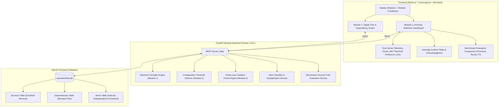

# CascadeShield AI – AI-Powered Cloud Resilience Digital Twin & Intelligent Failure Prevention Agent

CascadeShield AI is an intelligent cloud resilience platform providing virtual digital twin modeling, dependency analysis, AI-based anomaly detection, early warning alerts, and automated failure prevention.

---

## 1. System Architecture



---

## 2. Modules Overview

### 2.1. Module 1: Cloud Digital Twin & Dependency Mapping
- **9 Canonical Services**: API Gateway, Authentication, User, Product, Order, Payment, Notification, Database, and Cache.
- **Cytoscape.js Dependency Graph**: Hierarchical Dagre (LR/TB), Breadthfirst, and Cose layouts.
- **NetworkX DiGraph**: Real-time cycle detection, downstream blast radius traversal, and path routing.
- **Simulated Telemetry**: CPU, Memory, Latency, Error Rate, and Request Throughput.

### 2.2. Module 2: AI-Based Anomaly Detection and Early Warning
- **Threshold Rule Engine**: Configurable warning and critical operating limits for CPU, Memory, Latency, and Error Rate.
- **Scikit-Learn Isolation Forest**: Multivariate statistical outlier detection using high-dimensional feature spaces `[cpu, memory, latency, error_rate, request_volume]`.
- **Tri-Tier Severity Classification**: `Normal`, `Warning`, and `Critical` alerts with evidence summaries.
- **Deduplication & SQLite Persistence**: Prevents alert flooding within active incident windows; stores alerts in SQLite.
- **Interactive Metric Trends**: Recharts time-series visualization with warning/critical threshold lines and service selection.
- **Benchmark Evaluation**: Evaluates True Positives, False Positives, True Negatives, False Negatives, Precision, Recall, F1-Score, and False Positive Rate across 200 labeled observations.

### 2.3. Module 3: Cascading Failure Prediction Engine
- **Reverse Propagation Graph ($G_{prop} = G^{rev}$)**: Inverts callee $\to$ caller dependencies (e.g. Payment $\to$ Order $\to$ API Gateway) to model downstream blast radius.
- **Multi-Hop Traversal & Cycle Safety**: Cycle-safe BFS traversal with cutoff and non-cyclic path extraction (`nx.all_simple_paths`).
- **Normalized 0–100 Risk Scoring**: Combines base failure severity (`severe: 95`, `moderate: 70`, `mild: 40`), protocol coupling decay (`sync_http: 1.0`, `database_read_write: 0.95`, `async_message: 0.45`, `cache_lookup: 0.40`), attenuation factor, and Module 2 active anomaly alert telemetry amplification.
- **Multi-Path Confluence Risk Combination**: Independent probabilistic combination $R_{comb} = 100 \times (1 - \prod (1 - r_i / 100))$.
- **Discrete Time-Step Simulation Timeline**: Step-by-step failure wave progression tracking wave onset (+0s, +15s, +30s...), newly affected callers, cumulative blast radius, and average risk.
- **Ground-Truth Benchmark Comparison**: Evaluates Baseline Simple Traversal vs Static Rule Scoring vs Evidence-Aware Cascade across 5 synthetic cloud architectures.
- **Interactive Cyber-Resilience UI**: Cytoscape.js directed dashed propagation paths, failure scenario presets, timeline scrubber, and scenario comparison matrix.

---

## 3. REST API Reference

### Module 1 Endpoints
- `GET /api/health`: System health and SQLite connection status
- `GET /api/services`: List services with filtering by type, status, and search
- `GET /api/services/{id}`: Service detail with callers and downstream dependents
- `POST /api/services`: Register new cloud service
- `PUT /api/services/{id}`: Update service metadata and telemetry
- `DELETE /api/services/{id}`: Delete service (cascades dependencies)
- `GET /api/dependencies`: List dependencies
- `POST /api/dependencies`: Connect two services (cycle detection warning)
- `DELETE /api/dependencies/{id}`: Remove dependency
- `GET /api/graph`: Cytoscape-formatted graph payload
- `GET /api/graph/impact/{id}`: Downstream blast radius analysis
- `POST /api/graph/reset`: Reset to baseline 9-service topology
- `GET /api/metrics/summary`: Aggregate cluster health metrics

### Module 2 Endpoints
- `GET /api/anomalies/health`: Anomaly subsystem health
- `GET /api/anomalies/summary`: Total alerts, critical, warning, anomalous observations, and affected services
- `GET /api/anomalies`: Query alerts with pagination and filters (`service_id`, `severity`, `detection_method`, `acknowledged`)
- `GET /api/anomalies/{alert_id}`: Alert evidence details
- `POST /api/anomalies/detect`: Execute anomaly detection scan (`combined`, `threshold`, `isolation_forest`)
- `GET /api/anomalies/metrics/{service_id}`: Time-series telemetry points for chart visualization
- `GET /api/anomalies/thresholds`: Current threshold configuration
- `PUT /api/anomalies/thresholds`: Update warning and critical thresholds
- `GET /api/anomalies/evaluation`: Benchmark comparative metrics (Precision, Recall, F1)
- `POST /api/anomalies/{alert_id}/acknowledge`: Acknowledge an alert

### Module 3 Endpoints (Cascading Failure Prediction)
- `GET /api/cascade/health`: Cascade engine health status & capabilities
- `GET /api/cascade/summary`: Cluster-wide cascade risk overview & latest simulation metrics
- `POST /api/cascade/predict`: Predict blast radius, risk scores, and evidence for a failure scenario
- `POST /api/cascade/simulate`: Execute discrete time-step failure simulation timeline
- `GET /api/cascade/impact/{service_id}`: Directly and indirectly impacted callers for a service
- `GET /api/cascade/paths/{service_id}`: Propagation paths emerging from failing service
- `GET /api/cascade/scenarios`: List saved simulation scenarios (paginated)
- `POST /api/cascade/scenarios`: Save a simulation scenario and its prediction results into SQLite
- `GET /api/cascade/scenarios/{id}`: Retrieve saved scenario details
- `DELETE /api/cascade/scenarios/{id}`: Delete a saved scenario
- `GET /api/cascade/evaluation`: Benchmark comparative metrics against synthetic ground-truth
- `POST /api/cascade/compare`: Side-by-side comparative blast radius analysis across scenarios

---

## 4. Benchmark Evaluation Results

### Module 2 Anomaly Detection Benchmark (200 Labeled Observations)
| Metric | 1. Threshold Rules | 2. Isolation Forest (ML) | 3. Combined Alerting |
| :--- | :---: | :---: | :---: |
| **Precision** | ~95.2% | ~85.4% | ~93.0% |
| **Recall** | ~50.0% | ~87.5% | **100.0%** |
| **F1-Score** | 0.656 | 0.864 | **0.964** |
| **Accuracy** | 90.0% | 94.5% | **98.5%** |
| **False Positive Rate** | 0.6% | 3.8% | 1.9% |

### Module 3 Cascade Prediction Benchmark (5 Synthetic Topology Archetypes)
| Metric | 1. Baseline Simple Traversal | 2. Static Rule Scoring | 3. Evidence-Aware Cascade (Mod 3) |
| :--- | :---: | :---: | :---: |
| **Precision** | 70.0% | 77.8% | **100.0%** |
| **Recall** | 100.0% | 100.0% | **100.0%** |
| **F1-Score** | 0.824 | 0.875 | **1.000** |
| **False Positive Rate** | 60.0% | 40.0% | **0.0%** |
| **Detection Coverage** | 100.0% | 100.0% | **100.0%** |

*Key finding: Evidence-Aware Cascade eliminates false alarms in decoupled asynchronous and cached communication channels (0.0% FPR) while maintaining 100% recall on high-risk multi-hop synchronous cascades.*

---

## 5. Installation & Execution Guide

### 5.1. Run Automated Test Suite
From the root workspace:
```powershell
cd "backend"
python -m pytest -v
```
*(Runs all 69 tests across Module 1, Module 2, and Module 3 with 100% pass rate).*

### 5.2. Start FastAPI Backend
```powershell
cd "backend"
python -m uvicorn app.main:app --host 127.0.0.1 --port 8000 --reload
```
- API Base: `http://127.0.0.1:8000`
- Swagger Docs: `http://127.0.0.1:8000/docs`

### 5.3. Start React Frontend
In a second terminal:
```powershell
cd "frontend"
npm run dev
```
- Open `http://localhost:5173` in your browser.
- Switch between **Digital Twin & Graph (Module 1)**, **Anomaly Detection (Module 2)**, and **Cascade Engine (Module 3)** using the top navigation bar.

---

## 6. Assumptions & Limitations
1. **Simulated Telemetry**: All metrics and failure waves are non-destructive in-memory simulations for cloud resilience decision-support.
2. **Decision Support**: Heuristic risk scores reflect vulnerability and coupling severity rather than absolute failure guarantees.
3. **Integration Ready**: Prepared for Module 4 (Root Cause Analysis Engine) and Module 5 (Diagnostic Agent).

