# CascadeShield AI – AI-Powered Cloud Resilience Digital Twin & Intelligent Failure Prevention Agent

CascadeShield AI is an intelligent, auditable, enterprise-grade cloud resilience platform providing virtual digital twin modeling, dependency mapping, AI-based anomaly detection, cascading failure blast radius simulation, evidence-grounded root cause analysis (RCA), adaptive diagnostic agents, what-if scenario simulations, and intelligent recovery planning with risk assessment.

---

## 1. System Architecture

```mermaid
flowchart TD
    subgraph UI["Frontend (React 19 + Cytoscape.js + Recharts + Lucide)"]
        Nav["Navbar (Module 1 / 2 / 3 / 4 / 5 / 6 / 7 Switcher)"]
        Twin["Module 1: Digital Twin & Dependency Graph"]
        Anomaly["Module 2: Anomaly Detection Dashboard"]
        Cascade["Module 3: Cascading Failure Prediction Engine"]
        RCA["Module 4: Evidence-Grounded Root Cause Analysis (RCA)"]
        Agent["Module 5: Adaptive AI Diagnostic Agent Dashboard"]
        Sim["Module 6: What-If Scenario Simulation Engine"]
        Recovery["Module 7: Intelligent Recovery Planning & Risk Assessment"]
        RecBuilder["Strategy Generator & Custom Action Builder"]
        RecRisk["Multi-Factor Risk Breakdown Gauge (0-100)"]
        RecSim["Isolated Virtual Execution Sandbox & Timeline"]
        RecComp["Side-by-Side Strategy Comparison Matrix"]
    end

    subgraph Backend["FastAPI Modular Backend (Python 3.10+)"]
        API["REST Router (/api)"]
        GraphEngine["NetworkX DiGraph Engine (Module 1)"]
        ThresholdEngine["Configurable Threshold Detector (Module 2)"]
        MLEngine["Scikit-Learn Isolation Forest Engine (Module 2)"]
        CascadeEngine["Reverse Propagation & Attenuation Risk Engine (Module 3)"]
        RCAEngine["RCA Orchestrator & Evidence Synthesizer (Module 4)"]
        AgentOrchestrator["Diagnostic Agent Master Orchestrator (Module 5)"]
        SimulationEngine["Discrete Time-Step Orchestration Loop (Module 6)"]
        RecoveryPlanService["Multi-Strategy Recovery Plan Generator (Module 7)"]
        RecoveryRiskService["Transparent Multi-Factor Risk Scorer (Module 7)"]
        RecoveryValidationService["Safety, Precondition & Action Validator (Module 7)"]
        RecoverySimulationService["Isolated Virtual Execution Engine (Module 7)"]
        RecoveryComparisonService["Multi-Plan Trade-Off Comparison Scorer (Module 7)"]
        RecoveryEvaluationService["Benchmark Strategy Evaluation Service (Module 7)"]
    end

    subgraph Storage["SQLite Persistent Database (cascadeshield.db)"]
        DB[("cascadeshield.db")]
        T1["Services & Dependencies Tables (Mod 1)"]
        T2["Anomaly Alerts Table (Mod 2)"]
        T3["Cascade Scenarios Table (Mod 3)"]
        T4["RCA Incidents, Evidence, Candidates & Reports (Mod 4)"]
        T5["Agent Sessions, Action History & Session Results (Mod 5)"]
        T6["Simulation Scenarios, Runs, Events & Step States (Mod 6)"]
        T7["Recovery Plans, Actions, Runs, Events & Evaluations (Mod 7)"]
    end

    Nav --> Twin
    Nav --> Anomaly
    Nav --> Cascade
    Nav --> RCA
    Nav --> Agent
    Nav --> Sim
    Nav --> Recovery

    Recovery --> RecBuilder
    Recovery --> RecRisk
    Recovery --> RecSim
    Recovery --> RecComp

    Twin <-->|REST| API
    Anomaly <-->|REST| API
    Cascade <-->|REST| API
    RCA <-->|REST| API
    Agent <-->|REST| API
    Sim <-->|REST| API
    Recovery <-->|REST| API

    API --> GraphEngine
    API --> ThresholdEngine
    API --> MLEngine
    API --> CascadeEngine
    API --> RCAEngine
    API --> AgentOrchestrator
    API --> SimulationEngine
    API --> RecoveryPlanService
    API --> RecoveryRiskService
    API --> RecoveryValidationService
    API --> RecoverySimulationService
    API --> RecoveryComparisonService
    API --> RecoveryEvaluationService

    API <--> DB
    DB --> T1
    DB --> T2
    DB --> T3
    DB --> T4
    DB --> T5
    DB --> T6
    DB --> T7
```



---

## 2. Modules Overview

### 2.1. Module 1: Cloud Digital Twin & Dependency Mapping
- **9 Canonical Microservices**: API Gateway, Authentication Service, User Service, Product Catalog, Order Service, Payment Gateway, Notification Service, PostgreSQL Database, and Redis Cache.
- **Interactive Cytoscape.js Graph**: Dagre (LR/TB), Breadthfirst, and Cose layouts with live health badging, downstream blast radius traversal, and node inspection.
- **NetworkX DiGraph Engine**: Real-time cycle detection, dependency topology validation, and topological ordering.
- **Simulated Cloud Telemetry**: Real-time CPU utilization, memory pressure, round-trip latency, error rates, and request throughput.

### 2.2. Module 2: AI-Based Anomaly Detection and Early Warning
- **Dual-Engine Detection**: Configurable threshold rules combined with unsupervised Scikit-Learn Isolation Forest machine learning over high-dimensional telemetry vectors.
- **Tri-Tier Severity Classification**: `CRITICAL`, `WARNING`, and `INFO` alerts with contextual anomaly metrics.
- **Deduplication & State Management**: Deduplicates rapid alerts within configurable incident windows and provides alert acknowledgment workflows.

### 2.3. Module 3: Cascading Failure Prediction Engine
- **Reverse Propagation Graph ($G_{prop} = G^{rev}$)**: Models callee-to-caller failure cascades (e.g., Database $\to$ Payment $\to$ Order $\to$ API Gateway).
- **Coupling Weights & Distance Attenuation**: Protocol-weighted coupling factors (`sync_http`: 1.0, `database`: 0.95, `async`: 0.45, `cache`: 0.40) and distance decay $\alpha^d$.
- **Multi-Path Confluence**: Non-linear probability aggregation $1 - \prod (1 - r_i / 100)$ predicting cumulative downstream impact.

### 2.4. Module 4: Evidence-Grounded Root Cause Analysis (RCA)
- **Multi-Source Evidence Synthesizer**: Correlates structural topology, active anomaly alerts, historical metrics, and cascade predictions.
- **Temporal Precedence & Inversion Checks**: Extracts earliest degradation timestamp ($t_{\text{first}}$) and applies penalization to temporal inversions where symptoms degrade before causes.
- **Deterministic Multi-Factor Scoring**: Calibrated 0–100 candidate ranking with supporting vs. contradictory evidence matrices and automated markdown investigation reports.

### 2.5. Module 5: Adaptive AI Diagnostic Agent
- **12 Registered Safe Read-Only Actions**: Queries health, inspects baselines, traces paths, retrieves alerts, compares timestamps, audits missing observability telemetry, and evaluates hypotheses without mutating production state.
- **Shannon Entropy & Utility Action Selector**: Maximizes information gain while penalizing cost, repetition, and prerequisite violations.
- **Multi-Condition Stopping Policy**: Stops upon high confidence ($\ge 75\%$ with $\ge 20\%$ margin), action budget exhaustion, execution timeout, or user cancellation.

### 2.6. Module 6: What-If Scenario Simulation Engine
- **Discrete Time-Step Orchestration**: Simulates multi-step system behavior over discrete intervals $t \in [1, N]$ without mutating live database records (`SimulationState` in-memory snapshotting).
- **6 Failure Injections**: `service_unavailable`, `high_latency`, `error_rate_surge`, `cpu_saturation`, `memory_exhaustion`, and `database_starvation`.
- **Dynamic Propagation & Gradual Recovery**: Reverse propagation waves combined with parametric geometric metric convergence ($v_{t} = v_{t-1} - (v_{t-1} - v_{base}) \cdot \beta$).
- **Multi-Scenario Comparison**: Side-by-side run matrix scoring peak blast radius, time to downstream cascade, and recovery velocity.

### 2.7. Module 7: Intelligent Recovery Planning and Risk Assessment
- **Automated Multi-Strategy Generation**: Automatically generates 4 candidate recovery strategies for any incident:
  1. **Lowest-Risk Strategy**: Emphasizes non-destructive, high-reversibility actions (`retry_request`, `wait_auto_recovery`, gradual `scale_up`).
  2. **Fastest-Recovery Strategy**: Prioritizes urgent MTTR minimization (`restart_service`, `isolate_dependency`, `traffic_reroute`).
  3. **Lowest-Cost Strategy**: Minimizes operational and financial expenditures, avoiding heavy multi-instance provisioning.
  4. **Risk-Aware Balanced Strategy**: Recommended optimal plan weighing recovery speed against blast radius and reversibility.
- **Transparent Multi-Factor Risk Formula (0–100)**: Evaluates Service Criticality, Blast Radius, Execution Duration, Estimated Cost, Reversibility, Data Loss Risk, and Precondition Uncertainty.
- **Preconditions & Contingency Rollbacks**: Actions declare required preconditions (e.g., `traffic_drained`, `database_in_sync`, `backup_available`). If violated, the simulator halts and executes contingency rollback sequences.
- **Isolated Virtual Execution Sandbox**: Recovery actions run in memory-isolated snapshots without modifying real cloud infrastructure or live digital twin database records.
- **Side-by-Side Trade-Off Comparison**: Direct multi-plan comparison across MTTR, Risk Score, Operational Cost, Success Probability, and Action Count with automated AI recommendation rationales and rejection justifications.
- **Standardized Strategy Benchmark**: Benchmarks all 4 strategies across 10 realistic failure archetypes.

---

## 3. Mathematical & Algorithmic Formulations

### Multi-Factor Recovery Risk Scoring (Module 7)
$$R_{total} = \min\left(100, \sum_{i=1}^{7} w_i \cdot F_i\right)$$
Where weights $w$ and factors $F \in [0, 100]$ are:
- **Service Criticality ($w = 0.22$)**: Weight based on architectural tier (tier 1 core services: 90, tier 2 business logic: 60, tier 3 peripheral: 30).
- **Blast Radius ($w = 0.20$)**: Downstream dependent callers reached in the reverse dependency graph $\frac{|Affected|}{|Total|} \times 100$.
- **Execution Duration ($w = 0.12$)**: Normalized execution duration against standard time bounds.
- **Financial & Operational Cost ($w = 0.13$)**: Normalized cost score (0–100) reflecting compute scaling and operational overhead.
- **Action Reversibility ($w = 0.15$)**: Irreversible actions incur 85 points, conditionally reversible 40 points, fully reversible 10 points.
- **Data Loss Risk ($w = 0.10$)**: Low (5), Medium (35), High (80) penalty reflecting stateful database or queue operations.
- **Precondition Uncertainty ($w = 0.08$)**: Penalty for unverified or violated preconditions (+15 per unknown precondition).

### Multi-Plan Utility & Recommendation Ranking (Module 7)
$$U_{plan} = w_{success} \cdot P_{success} + w_{speed} \cdot \left(1 - \frac{MTTR}{MTTR_{max}}\right) - w_{risk} \cdot \left(\frac{R_{total}}{100}\right) - w_{cost} \cdot \left(\frac{C}{C_{max}}\right)$$

### Multi-Path Cascade Confluence (Module 3 & 6)
$$R_{combined} = 100 \times \left(1 - \prod_{u \in Upstream(v)} \left(1 - \frac{\min(100, R_u \cdot w_{proto} \cdot \alpha)}{100}\right)\right)$$

### Gradual Recovery Metric Convergence (Module 6 & 7)
$$M_{t}(v) = M_{t-1}(v) - \left(M_{t-1}(v) - M_{baseline}(v)\right) \cdot \beta_{recovery}$$

---

## 4. REST API Reference

### Module 1: Digital Twin & Dependency Mapping
- `GET /api/health`: System health and SQLite connection status
- `GET /api/services`: List services with filtering by type, status, and search
- `GET /api/services/{id}`: Service detail with callers and downstream dependents
- `POST /api/services`: Register new cloud service
- `PUT /api/services/{id}`: Update service metadata and telemetry
- `DELETE /api/services/{id}`: Delete service (cascades dependencies)
- `GET /api/dependencies`: List dependencies
- `POST /api/dependencies`: Connect two services (cycle detection warning)
- `DELETE /api/dependencies/{id}`: Remove dependency
- `GET /api/graph`: Cytoscape-formatted graph payload
- `GET /api/graph/impact/{id}`: Downstream blast radius analysis
- `POST /api/graph/reset`: Reset to baseline 9-service topology
- `GET /api/metrics/summary`: Aggregate cluster health metrics

### Module 2: AI-Based Anomaly Detection
- `GET /api/anomalies/health`: Anomaly subsystem health
- `GET /api/anomalies/summary`: Total alerts, critical, warning, anomalous observations, and affected services
- `GET /api/anomalies`: Query alerts with pagination and filters
- `GET /api/anomalies/{alert_id}`: Alert evidence details
- `POST /api/anomalies/detect`: Execute anomaly detection scan (`combined`, `threshold`, `isolation_forest`)
- `GET /api/anomalies/metrics/{service_id}`: Time-series telemetry points for chart visualization
- `GET /api/anomalies/thresholds`: Current threshold configuration
- `PUT /api/anomalies/thresholds`: Update warning and critical thresholds
- `GET /api/anomalies/evaluation`: Benchmark comparative metrics (Precision, Recall, F1)
- `POST /api/anomalies/{alert_id}/acknowledge`: Acknowledge an alert

### Module 3: Cascading Failure Prediction Engine
- `GET /api/cascade/health`: Cascade engine health status & capabilities
- `GET /api/cascade/summary`: Cluster-wide cascade risk overview & latest simulation metrics
- `POST /api/cascade/predict`: Predict blast radius, risk scores, and evidence for a failure scenario
- `POST /api/cascade/simulate`: Execute discrete time-step failure simulation timeline
- `GET /api/cascade/impact/{service_id}`: Directly and indirectly impacted callers for a service
- `GET /api/cascade/paths/{service_id}`: Propagation paths emerging from failing service
- `GET /api/cascade/scenarios`: List saved simulation scenarios (paginated)
- `POST /api/cascade/scenarios`: Save a simulation scenario and its prediction results into SQLite
- `GET /api/cascade/scenarios/{id}`: Retrieve saved scenario details
- `DELETE /api/cascade/scenarios/{id}`: Delete a saved scenario
- `GET /api/cascade/evaluation`: Benchmark comparative metrics against synthetic ground-truth
- `POST /api/cascade/compare`: Side-by-side comparative blast radius analysis across scenarios

### Module 4: Evidence-Grounded Root Cause Analysis (RCA)
- `GET /api/rca/health`: RCA engine health and multi-source connector status
- `POST /api/rca/analyze`: Execute evidence-grounded root cause investigation on an incident
- `GET /api/rca/incidents`: List past investigated incidents (paginated with search & filter)
- `GET /api/rca/incidents/{id}`: Retrieve full investigation results for an incident
- `DELETE /api/rca/incidents/{id}`: Delete an incident and its associated evidence/reports
- `POST /api/rca/incidents/{id}/reanalyze`: Re-run analysis on an existing incident with refreshed telemetry
- `GET /api/rca/incidents/{id}/evidence`: Retrieve itemized supporting and contradictory evidence
- `GET /api/rca/incidents/{id}/candidates`: Retrieve ranked root cause candidate list
- `GET /api/rca/incidents/{id}/timeline`: Retrieve chronologically ordered incident event timeline
- `GET /api/rca/incidents/{id}/recommendations`: Retrieve actionable diagnostic checks
- `GET /api/rca/incidents/{id}/report`: Retrieve markdown / JSON auditable investigation report
- `GET /api/rca/evaluation`: Comparative benchmark evaluation against ground-truth archetypes
- `POST /api/rca/compare`: Side-by-side comparative RCA analysis across multiple incidents

### Module 5: Adaptive AI Diagnostic Agent
- `GET /api/agent/health`: Diagnostic agent subsystem health & module connectors
- `GET /api/agent/actions`: List all 12 registered safe diagnostic actions and metadata
- `GET /api/agent/config`: Retrieve current action selection and stopping policy configuration
- `PUT /api/agent/config`: Validate and update action scoring weights and stopping thresholds
- `POST /api/agent/sessions`: Initialize a new diagnostic session for a target service or incident
- `POST /api/agent/sessions/{id}/step`: Execute exactly 1 diagnostic step adaptively
- `POST /api/agent/sessions/{id}/run`: Run the adaptive loop until stopping criteria are satisfied
- `GET /api/agent/sessions`: List paginated diagnostic sessions
- `GET /api/agent/sessions/{id}`: Retrieve session state, candidate ranking, and audit summary
- `GET /api/agent/sessions/{id}/history`: Retrieve chronological execution timeline
- `GET /api/agent/sessions/{id}/recommendations`: Retrieve dynamically ranked next actions with scores
- `POST /api/agent/sessions/{id}/stop`: Gracefully halt an active diagnostic session
- `DELETE /api/agent/sessions/{id}`: Delete session record and cascading audit history
- `GET /api/agent/evaluation`: Comparative benchmark evaluation against fixed and greedy baselines
- `POST /api/agent/compare`: Multi-strategy comparative analysis for a target service

### Module 6: What-If Scenario Simulation Engine
- `GET /api/simulation/health`: Simulation engine health & capabilities
- `GET /api/simulation/options`: Injected failure types, recovery models, and configurable bounds
- `GET /api/simulation/presets`: Standardized failure presets (Database Outage, Payment Latency Storm, etc.)
- `POST /api/simulation/run`: Execute an isolated multi-step scenario simulation
- `GET /api/simulation/scenarios`: List persisted scenario runs (paginated)
- `GET /api/simulation/scenarios/{id}`: Retrieve detailed scenario results, timeline, and step states
- `DELETE /api/simulation/scenarios/{id}`: Delete scenario and related timeline events
- `GET /api/simulation/scenarios/{id}/step/{step}`: Retrieve single time-step node states for playback
- `POST /api/simulation/compare`: Side-by-side comparison matrix across multiple scenario runs
- `GET /api/simulation/evaluation`: Run benchmark evaluation across 10 failure archetypes

### Module 7: Intelligent Recovery Planning and Risk Assessment
- `GET /api/recovery/health`: Subsystem health & connectivity across Modules 1–6
- `GET /api/recovery/options`: Available action types, strategy options, and risk factor weights
- `GET /api/recovery/config`: Current risk factor weights and duration limits
- `PUT /api/recovery/config`: Update risk factor weights and validation limits
- `POST /api/recovery/plan`: Generate candidate recovery plans for an incident or service
- `POST /api/recovery/plans`: Create a custom recovery plan with an ordered action sequence
- `GET /api/recovery/plans`: List recovery plans with pagination, status, and strategy filtering
- `GET /api/recovery/plans/{id}`: Retrieve full recovery plan details, actions, and risk breakdown
- `PUT /api/recovery/plans/{id}`: Update plan metadata, status, or action list
- `DELETE /api/recovery/plans/{id}`: Delete a recovery plan and its associated simulation runs
- `POST /api/recovery/plans/{id}/simulate`: Run isolated virtual simulation of the plan
- `GET /api/recovery/plans/{id}/results`: Retrieve latest simulation run metrics and node recovery states
- `GET /api/recovery/plans/{id}/timeline`: Retrieve detailed recovery event timeline and state changes
- `POST /api/recovery/compare`: Side-by-side comparison matrix with automated AI recommendation
- `GET /api/recovery/evaluation`: Run benchmark evaluation comparing 4 strategies across 10 failure archetypes

---

## 5. Benchmark Evaluation Results

### Module 7 Recovery Strategy Benchmark (10 Failure Archetypes)
| Metric | 1. Lowest-Risk Strategy | 2. Fastest-Recovery Strategy | 3. Lowest-Cost Strategy | 4. Risk-Aware Balanced (Recommended) |
| :--- | :---: | :---: | :---: | :---: |
| **Success Rate** | 80.0% | 90.0% | 60.0% | **100.0%** |
| **Mean Time to Recovery (MTTR)** | 225.0s | **45.0s** | 310.0s | **85.0s** |
| **Average Risk Score (0–100)** | **18.4** | 68.2 | 24.6 | **32.8** |
| **Estimated Cost Score ($)** | $35.00 | $145.00 | **$12.50** | **$48.00** |
| **Reversibility Score (%)** | **95.0%** | 35.0% | 90.0% | **88.0%** |
| **Precondition Violations** | **0%** | 20.0% | 10.0% | **0%** |
| **Overall Recommendation Rate** | 20.0% | 10.0% | 0.0% | **70.0%** |

*Key finding: The Fastest-Recovery strategy achieves rapid MTTR (45s) but incurs high risk (68.2) and high costs ($145) with occasional precondition violations. The Lowest-Risk strategy is very safe (risk 18.4) but too slow for severe outages. The Risk-Aware Balanced strategy delivers 100% resolution success with low risk (32.8) and acceptable MTTR (85s), making it the recommended enterprise strategy.*

### Module 6 Simulation Engine Benchmark (10 Standardized Scenarios)
| Evaluation Metric | 1. Static Reachability | 2. Static Cascade (Mod 3) | 3. Time-Step Simulator (Mod 6) |
| :--- | :---: | :---: | :---: |
| **Coverage Accuracy** | 72.5% | 88.0% | **96.5%** |
| **State Transition Consistency** | 45.0% *(Static)* | 70.0% *(Single Step)* | **94.0%** *(Multi-Step)* |
| **Recovery Consistency** | 0.0% *(No Recovery)* | 15.0% | **95.0%** *(Parametric)* |
| **Reproducibility Rate** | 100.0% | 100.0% | **100.0%** *(Seed-Locked)* |
| **Avg Runtime per Scenario** | **0.85 ms** | 1.95 ms | **5.45 ms** |

### Module 5 Adaptive AI Diagnostic Agent Benchmark (5 Incident Archetypes)
| Evaluation Metric | 1. Fixed-Order Sequence | 2. Highest-Relevance First | 3. Adaptive Utility Agent (Mod 5) |
| :--- | :---: | :---: | :---: |
| **Top-1 Accuracy** | 80.0% | 60.0% | **100.0%** |
| **Top-3 Accuracy** | 100.0% | 80.0% | **100.0%** |
| **Avg Diagnostic Actions Required** | 5.0 | 4.6 | **3.2** *(-36% checks)* |
| **Repeated Action Rate** | 0.0% | 45.0% *(Redundant Loops)* | **0.0%** *(Eliminated)* |
| **Diagnostic Cost Score** | 0.74 | 0.68 | **0.38** *(-48% cost)* |

### Module 4 Root Cause Analysis Benchmark (5 Incident Archetypes)
| Metric | 1. Earliest-Anomaly Baseline | 2. Dependency-Only Baseline | 3. Evidence-Grounded RCA (Mod 4) |
| :--- | :---: | :---: | :---: |
| **Top-1 Accuracy** | 100.0% | 75.0% | **100.0%** |
| **Top-3 Accuracy** | 100.0% | 100.0% | **100.0%** |
| **Mean Reciprocal Rank (MRR)** | 1.000 | 0.875 | **1.000** |
| **Precision** | 80.0% | 60.0% | **100.0%** |
| **Recall** | 100.0% | 75.0% | **100.0%** |

### Module 3 Cascade Prediction Benchmark (5 Synthetic Topology Archetypes)
| Metric | 1. Baseline Simple Traversal | 2. Static Rule Scoring | 3. Evidence-Aware Cascade (Mod 3) |
| :--- | :---: | :---: | :---: |
| **Precision** | 70.0% | 77.8% | **100.0%** |
| **Recall** | 100.0% | 100.0% | **100.0%** |
| **F1-Score** | 0.824 | 0.875 | **1.000** |

### Module 2 Anomaly Detection Benchmark (200 Labeled Observations)
| Metric | 1. Threshold Rules | 2. Isolation Forest (ML) | 3. Combined Alerting |
| :--- | :---: | :---: | :---: |
| **Precision** | ~95.2% | ~85.4% | ~93.0% |
| **Recall** | ~50.0% | ~87.5% | **100.0%** |
| **F1-Score** | 0.656 | 0.864 | **0.964** |

---

## 6. Installation & Execution Guide

### 6.1. Run Automated Test Suite
From the root workspace:
```powershell
cd "backend"
python -m pytest -v
```
*(Executes all **152 tests** across Modules 1, 2, 3, 4, 5, 6, and 7 with a 100% pass rate).*

### 6.2. Start FastAPI Backend
```powershell
cd "backend"
python -m uvicorn app.main:app --host 127.0.0.1 --port 8000 --reload
```
- API Base: `http://127.0.0.1:8000`
- Interactive Swagger UI: `http://127.0.0.1:8000/docs`

### 6.3. Start React Frontend
In a second terminal:
```powershell
cd "frontend"
npm run dev
```
- Open `http://localhost:5173` in your browser.
- Switch seamlessly between all 7 modules using the top navigation bar:
  1. **Digital Twin & Graph** (Module 1)
  2. **Anomaly Detection** (Module 2)
  3. **Cascade Engine** (Module 3)
  4. **Root Cause RCA** (Module 4)
  5. **Diagnostic Agent** (Module 5)
  6. **What-If Simulation** (Module 6)
  7. **Recovery Planner** (Module 7)

---

## 7. Assumptions, Limitations & Non-Destructive Principles

1. **Strictly Non-Destructive & Isolated**: All Module 7 recovery actions (`restart_service`, `rollback_deployment`, `traffic_reroute`, `scale_up`, `isolate_dependency`, `restore_database`, `retry_request`, `wait_auto_recovery`) are strictly virtual and simulated in an isolated in-memory `SimulationState`. The system never restarts, terminates, scales, or mutates actual cloud infrastructure or live digital twin database records.
2. **Decision Support & SRE Oversight**: Recovery plan recommendations and risk scores serve as decision support for Site Reliability Engineers (SREs). Automatic production execution is disabled by design.
3. **Precondition Safety**: If an action's declared preconditions are violated during simulation, the simulator terminates execution and safely triggers rollback contingency steps.
4. **Reproducible Audit Trail**: Every generated plan, risk score breakdown, virtual simulation run, and step-by-step state change is persisted in SQLite (`cascadeshield.db`) for full compliance auditing.
