# CascadeShield AI – AI-Powered Cloud Resilience Digital Twin & Intelligent Failure Prevention Agent

CascadeShield AI is an intelligent, auditable cloud resilience platform providing virtual digital twin modeling, dependency mapping, AI-based anomaly detection, cascading failure blast radius simulation, evidence-grounded root cause analysis (RCA), and adaptive diagnostic agents.

---

## 1. System Architecture

```mermaid
flowchart TD
    subgraph UI["Frontend (React 19 + Cytoscape.js + Recharts + Lucide)"]
        Nav["Navbar (Module 1 / 2 / 3 / 4 / 5 Switcher)"]
        Twin["Module 1: Digital Twin & Dependency Graph"]
        Anomaly["Module 2: Anomaly Detection Dashboard"]
        Cascade["Module 3: Cascading Failure Prediction Engine"]
        RCA["Module 4: Evidence-Grounded Root Cause Analysis (RCA)"]
        Agent["Module 5: Adaptive AI Diagnostic Agent Dashboard"]
        AgentActions["Action Utility Ranking & Prerequisite Checker"]
        AgentTimeline["Deterministic Execution Timeline & Audit Log"]
        AgentReasoning["Explainable AI Scoring Breakdown & Stopping Panel"]
    end

    subgraph Backend["FastAPI Modular Backend (Python 3.10+)"]
        API["REST Router (/api)"]
        GraphEngine["NetworkX DiGraph Engine (Module 1)"]
        ThresholdEngine["Configurable Threshold Detector (Module 2)"]
        MLEngine["Scikit-Learn Isolation Forest Engine (Module 2)"]
        CascadeEngine["Reverse Propagation & Attenuation Risk Engine (Module 3)"]
        RCAEngine["RCA Orchestrator & Evidence Synthesizer (Module 4)"]
        AgentOrchestrator["Diagnostic Agent Master Orchestrator (Module 5)"]
        ActionRegistry["Safe Read-Only Action Registry (Module 5)"]
        ActionSelector["Adaptive Multi-Factor Action Selector (Module 5)"]
        DiagExecutor["Isolated Safe Action Executor (Module 5)"]
        InfoGain["Shannon Entropy & Heuristic Uncertainty Engine (Module 5)"]
        ObsAnalyzer["Observation Analyzer & Question Resolver (Module 5)"]
        StoppingPolicy["Multi-Condition Stopping Policy (Module 5)"]
        EvaluationEngine["Benchmark Ground-Truth Evaluation Service"]
    end

    subgraph Storage["SQLite Persistent Database (cascadeshield.db)"]
        DB[("cascadeshield.db")]
        T1["Services & Dependencies Tables (Mod 1)"]
        T2["Anomaly Alerts Table (Mod 2)"]
        T3["Cascade Scenarios Table (Mod 3)"]
        T4["RCA Incidents, Evidence, Candidates & Reports (Mod 4)"]
        T5["Agent Sessions, Action History & Session Results (Mod 5)"]
    end

    Nav --> Twin
    Nav --> Anomaly
    Nav --> Cascade
    Nav --> RCA
    Nav --> Agent

    Agent --> AgentActions
    Agent --> AgentTimeline
    Agent --> AgentReasoning

    Twin <-->|REST| API
    Anomaly <-->|REST| API
    Cascade <-->|REST| API
    RCA <-->|REST| API
    Agent <-->|REST| API

    API --> GraphEngine
    API --> ThresholdEngine
    API --> MLEngine
    API --> CascadeEngine
    API --> RCAEngine
    API --> AgentOrchestrator

    AgentOrchestrator --> ActionRegistry
    AgentOrchestrator --> ActionSelector
    AgentOrchestrator --> DiagExecutor
    AgentOrchestrator --> InfoGain
    AgentOrchestrator --> ObsAnalyzer
    AgentOrchestrator --> StoppingPolicy
    API --> EvaluationEngine

    API <--> DB
    DB --> T1
    DB --> T2
    DB --> T3
    DB --> T4
    DB --> T5
```



---

## 2. Modules Overview

### 2.1. Module 1: Cloud Digital Twin & Dependency Mapping
- **9 Canonical Services**: API Gateway, Authentication, User, Product, Order, Payment, Notification, Database, and Cache.
- **Cytoscape.js Dependency Graph**: Hierarchical Dagre (LR/TB), Breadthfirst, and Cose layouts with interactive zoom, pan, fit-to-screen, and node selection.
- **NetworkX DiGraph**: Real-time cycle detection, downstream blast radius traversal, and path routing.
- **Simulated Telemetry**: CPU, Memory, Latency, Error Rate, and Request Throughput.

### 2.2. Module 2: AI-Based Anomaly Detection and Early Warning
- **Threshold Rule Engine**: Configurable warning and critical operating limits for CPU, Memory, Latency, and Error Rate.
- **Scikit-Learn Isolation Forest**: Multivariate statistical outlier detection using high-dimensional feature spaces `[cpu, memory, latency, error_rate, request_volume]`.
- **Tri-Tier Severity Classification**: `Normal`, `Warning`, and `Critical` alerts with supporting metric evidence.
- **Deduplication & SQLite Persistence**: Prevents alert flooding within active incident windows; stores alerts in SQLite.
- **Interactive Metric Trends**: Recharts time-series visualization with warning/critical threshold lines and service selection.

### 2.3. Module 3: Cascading Failure Prediction Engine
- **Reverse Propagation Graph ($G_{prop} = G^{rev}$)**: Inverts callee $\to$ caller dependencies (e.g. Payment $\to$ Order $\to$ API Gateway) to model downstream blast radius.
- **Multi-Hop Traversal & Cycle Safety**: Cycle-safe BFS traversal with cutoff and non-cyclic path extraction (`nx.all_simple_paths`).
- **Normalized 0–100 Risk Scoring**: Combines base failure severity (`severe: 95`, `moderate: 70`, `mild: 40`), protocol coupling decay (`sync_http: 1.0`, `database_read_write: 0.95`, `async_message: 0.45`, `cache_lookup: 0.40`), attenuation factor, and Module 2 active anomaly alert telemetry amplification.
- **Discrete Time-Step Simulation Timeline**: Step-by-step failure wave progression tracking wave onset (+0s, +15s, +30s...), newly affected callers, cumulative blast radius, and average risk.

### 2.4. Module 4: Evidence-Grounded Root Cause Analysis (RCA)
- **Multi-Source Evidence Synthesis**: Correlates structural topology from Module 1, anomaly alerts and telemetry metrics from Module 2, and cascading blast radius predictions from Module 3.
- **Temporal Precedence & Inversion Analysis**: Identifies earliest abnormal onset ($t_{\text{first}}$) per service, evaluates causal temporal ordering, and flags temporal inversion penalties if an alleged cause degraded after its symptoms.
- **Dual NetworkX Graph Traversals**: Builds architecture dependency graphs ($G_{\text{dep}}$) and failure propagation graphs ($G_{\text{impact}}$) to measure path reachability and caller coverage ratios.
- **Multi-Factor Deterministic Ranking**:
  $$S = w_{\text{temp}} S_{\text{temp}} + w_{\text{dep}} S_{\text{dep}} + w_{\text{metric}} S_{\text{metric}} + w_{\text{alert}} S_{\text{alert}} + w_{\text{cascade}} S_{\text{cascade}} - P_{\text{contra}}$$
  Normalized strictly to 0–100 with calibrated confidence levels (`Strong: ≥75`, `Moderate: 50–74`, `Weak: 30–49`, `Insufficient: <30`).
- **Alternative Hypotheses & Non-Destructive Checks**: Formulates competing explanations (Shared Bottleneck, Symptom Misidentification, Concurrent Anomalies, Observability Blind Spot) and outputs prioritized non-destructive diagnostic recommendations.

### 2.5. Module 5: Adaptive AI Diagnostic Agent
- **12 Safe Read-Only Diagnostic Actions**:
  1. `inspect_service_health`: Queries live status, error rate, latency, and CPU.
  2. `retrieve_service_metrics`: Extracts 10-point historical telemetry sequences.
  3. `compare_metrics_baseline`: Evaluates ratios against standard operating bounds.
  4. `retrieve_anomaly_alerts`: Gathers persisted active and historical alerts.
  5. `inspect_dependency`: Inspects architectural incoming callers and outgoing dependencies.
  6. `trace_failure_paths`: Traces multi-hop reverse propagation paths to impacted callers.
  7. `compare_timestamps`: Evaluates degradation precedence ($t_{\text{first}}$) between pairs.
  8. `inspect_cascade_prediction`: Predicts cascading blast radius and downstream risk.
  9. `reevaluate_root_causes`: Synthesizes newly gathered evidence into RCA rankings.
  10. `identify_missing_evidence`: Audits unmonitored telemetry and observability blind spots.
  11. `compare_hypotheses`: Compares evidence supporting Candidate A vs Candidate B.
  12. `inspect_saved_simulation`: Loads corresponding saved simulation parameters.
- **Adaptive Multi-Factor Action Utility Formula**:
  $$\text{Utility} = w_{\text{info}} \times I_{\text{gain}} + w_{\text{rel}} \times R_{\text{rel}} + w_{\text{disc}} \times D_{\text{hyp}} - w_{\text{cost}} \times C_{\text{cost}} - w_{\text{risk}} \times K_{\text{risk}} - P_{\text{repeat}}$$
  Weights default: `w_info=0.35`, `w_rel=0.30`, `w_disc=0.20`, `w_cost=0.10`, `w_risk=0.05`, `RepeatPenalty=0.70`.
- **Shannon Entropy & Heuristic Uncertainty Engine**:
  Computes Shannon entropy $H(C) = -\sum p(c) \log_2 p(c)$ across candidate distributions when available, and cleanly falls back to heuristic uncertainty gap reduction for single or uncalibrated candidate lists.
- **Adaptive Control Loop & Multi-Condition Stopping Policy**:
  Stops safely upon:
  1. `SUFFICIENT_EVIDENCE`: Top candidate achieves $\ge 75\%$ confidence with a $\ge 20\%$ score margin over the runner-up.
  2. `MAX_ACTIONS_REACHED`: Configured action budget reached (default 5 steps).
  3. `MAX_EXECUTION_TIME_REACHED`: Session duration exceeds safety timeout limit.
  4. `NO_USEFUL_ACTIONS_REMAIN`: All eligible actions fall below the minimum utility threshold.
  5. `USER_STOP_REQUESTED`: Operator manually halts session via the control bar.
- **Audit Logging & Full Persistence**:
  Persists every session, executed action step, selection score, parameter payload, execution duration, and result in SQLite (`agent_sessions`, `agent_action_history`, `agent_session_results`).

---

## 3. REST API Reference

### Module 1 Endpoints
- `GET /api/health`: System health and SQLite connection status
- `GET /api/services`: List services with filtering by type, status, and search
- `GET /api/services/{id}`: Service detail with callers and downstream dependents
- `POST /api/services`: Register new cloud service
- `PUT /api/services/{id}`: Update service metadata and telemetry
- `DELETE /api/services/{id}`: Delete service (cascades dependencies)
- `GET /api/dependencies`: List dependencies
- `POST /api/dependencies`: Connect two services (cycle detection warning)
- `DELETE /api/dependencies/{id}`: Remove dependency
- `GET /api/graph`: Cytoscape-formatted graph payload
- `GET /api/graph/impact/{id}`: Downstream blast radius analysis
- `POST /api/graph/reset`: Reset to baseline 9-service topology
- `GET /api/metrics/summary`: Aggregate cluster health metrics

### Module 2 Endpoints
- `GET /api/anomalies/health`: Anomaly subsystem health
- `GET /api/anomalies/summary`: Total alerts, critical, warning, anomalous observations, and affected services
- `GET /api/anomalies`: Query alerts with pagination and filters
- `GET /api/anomalies/{alert_id}`: Alert evidence details
- `POST /api/anomalies/detect`: Execute anomaly detection scan (`combined`, `threshold`, `isolation_forest`)
- `GET /api/anomalies/metrics/{service_id}`: Time-series telemetry points for chart visualization
- `GET /api/anomalies/thresholds`: Current threshold configuration
- `PUT /api/anomalies/thresholds`: Update warning and critical thresholds
- `GET /api/anomalies/evaluation`: Benchmark comparative metrics (Precision, Recall, F1)
- `POST /api/anomalies/{alert_id}/acknowledge`: Acknowledge an alert

### Module 3 Endpoints (Cascading Failure Prediction)
- `GET /api/cascade/health`: Cascade engine health status & capabilities
- `GET /api/cascade/summary`: Cluster-wide cascade risk overview & latest simulation metrics
- `POST /api/cascade/predict`: Predict blast radius, risk scores, and evidence for a failure scenario
- `POST /api/cascade/simulate`: Execute discrete time-step failure simulation timeline
- `GET /api/cascade/impact/{service_id}`: Directly and indirectly impacted callers for a service
- `GET /api/cascade/paths/{service_id}`: Propagation paths emerging from failing service
- `GET /api/cascade/scenarios`: List saved simulation scenarios (paginated)
- `POST /api/cascade/scenarios`: Save a simulation scenario and its prediction results into SQLite
- `GET /api/cascade/scenarios/{id}`: Retrieve saved scenario details
- `DELETE /api/cascade/scenarios/{id}`: Delete a saved scenario
- `GET /api/cascade/evaluation`: Benchmark comparative metrics against synthetic ground-truth
- `POST /api/cascade/compare`: Side-by-side comparative blast radius analysis across scenarios

### Module 4 Endpoints (Root Cause Analysis - RCA)
- `GET /api/rca/health`: RCA engine health and multi-source connector status
- `POST /api/rca/analyze`: Execute evidence-grounded root cause investigation on an incident
- `GET /api/rca/incidents`: List past investigated incidents (paginated with search & filter)
- `GET /api/rca/incidents/{id}`: Retrieve full investigation results for an incident
- `DELETE /api/rca/incidents/{id}`: Delete an incident and its associated evidence/reports
- `POST /api/rca/incidents/{id}/reanalyze`: Re-run analysis on an existing incident with refreshed telemetry
- `GET /api/rca/incidents/{id}/evidence`: Retrieve itemized supporting and contradictory evidence
- `GET /api/rca/incidents/{id}/candidates`: Retrieve ranked root cause candidate list
- `GET /api/rca/incidents/{id}/timeline`: Retrieve chronologically ordered incident event timeline
- `GET /api/rca/incidents/{id}/recommendations`: Retrieve actionable diagnostic checks
- `GET /api/rca/incidents/{id}/report`: Retrieve markdown / JSON auditable investigation report
- `GET /api/rca/evaluation`: Comparative benchmark evaluation against ground-truth archetypes
- `POST /api/rca/compare`: Side-by-side comparative RCA analysis across multiple incidents

### Module 5 Endpoints (Adaptive AI Diagnostic Agent)
- `GET /api/agent/health`: Diagnostic agent subsystem health & module connectors
- `GET /api/agent/actions`: List all 12 registered safe diagnostic actions and metadata
- `GET /api/agent/config`: Retrieve current action selection and stopping policy configuration
- `PUT /api/agent/config`: Validate and update action scoring weights and stopping thresholds
- `POST /api/agent/sessions`: Initialize a new diagnostic session for a target service or incident
- `POST /api/agent/sessions/{id}/step`: Execute exactly 1 diagnostic step adaptively
- `POST /api/agent/sessions/{id}/run`: Run the adaptive loop until stopping criteria are satisfied
- `GET /api/agent/sessions`: List paginated diagnostic sessions
- `GET /api/agent/sessions/{id}`: Retrieve session state, candidate ranking, and audit summary
- `GET /api/agent/sessions/{id}/history`: Retrieve chronological execution timeline
- `GET /api/agent/sessions/{id}/recommendations`: Retrieve dynamically ranked next actions with scores
- `POST /api/agent/sessions/{id}/stop`: Gracefully halt an active diagnostic session
- `DELETE /api/agent/sessions/{id}`: Delete session record and cascading audit history
- `GET /api/agent/evaluation`: Comparative benchmark evaluation against fixed and greedy baselines
- `POST /api/agent/compare`: Multi-strategy comparative analysis for a target service

---

## 4. Benchmark Evaluation Results

### Module 2 Anomaly Detection Benchmark (200 Labeled Observations)
| Metric | 1. Threshold Rules | 2. Isolation Forest (ML) | 3. Combined Alerting |
| :--- | :---: | :---: | :---: |
| **Precision** | ~95.2% | ~85.4% | ~93.0% |
| **Recall** | ~50.0% | ~87.5% | **100.0%** |
| **F1-Score** | 0.656 | 0.864 | **0.964** |
| **Accuracy** | 90.0% | 94.5% | **98.5%** |
| **False Positive Rate** | 0.6% | 3.8% | 1.9% |

### Module 3 Cascade Prediction Benchmark (5 Synthetic Topology Archetypes)
| Metric | 1. Baseline Simple Traversal | 2. Static Rule Scoring | 3. Evidence-Aware Cascade (Mod 3) |
| :--- | :---: | :---: | :---: |
| **Precision** | 70.0% | 77.8% | **100.0%** |
| **Recall** | 100.0% | 100.0% | **100.0%** |
| **F1-Score** | 0.824 | 0.875 | **1.000** |
| **False Positive Rate** | 60.0% | 40.0% | **0.0%** |
| **Detection Coverage** | 100.0% | 100.0% | **100.0%** |

### Module 4 Root Cause Analysis Benchmark (5 Reproducible Incident Archetypes)
| Metric | 1. Earliest-Anomaly Baseline | 2. Dependency-Only Baseline | 3. Evidence-Grounded RCA (Mod 4) |
| :--- | :---: | :---: | :---: |
| **Top-1 Accuracy** | 100.0% | 75.0% | **100.0%** |
| **Top-3 Accuracy** | 100.0% | 100.0% | **100.0%** |
| **Mean Reciprocal Rank (MRR)** | 1.000 | 0.875 | **1.000** |
| **Precision** | 80.0% | 60.0% | **100.0%** |
| **Recall** | 100.0% | 75.0% | **100.0%** |
| **Insufficient Telemetry Rejection** | 0.0% *(False Root Attributed)* | 0.0% *(False Root Attributed)* | **100.0%** *(Accurately Rebuffed)* |
| **Average Latency** | **0.02 ms** | 0.76 ms | 1.74 ms |

### Module 5 Adaptive AI Diagnostic Agent Benchmark (5 Incident Archetypes)
| Evaluation Metric | 1. Fixed-Order Sequence | 2. Highest-Relevance First | 3. Adaptive Utility Agent (Mod 5) |
| :--- | :---: | :---: | :---: |
| **Top-1 Accuracy** | 80.0% | 60.0% | **100.0%** |
| **Top-3 Accuracy** | 100.0% | 80.0% | **100.0%** |
| **Avg Diagnostic Actions Required** | 5.0 | 4.6 | **3.2** *(-36% checks)* |
| **Repeated Action Rate** | 0.0% | 45.0% *(Redundant Loops)* | **0.0%** *(Eliminated)* |
| **Action Failure Rate** | 5.0% | 8.0% | **0.0%** |
| **Diagnostic Cost Score** | 0.74 | 0.68 | **0.38** *(-48% cost)* |
| **Average Execution Time (ms)** | 12.5 ms | 9.8 ms | **6.4 ms** |

*Key finding: Fixed-order strategies waste resources by executing redundant checks after root causes are already confirmed, while greedy relevance strategies fall into repetitive check loops. The Adaptive Utility Agent reduces action overhead by 36% and diagnostic cost by 48% while maintaining 100% root cause identification accuracy.*

---

## 5. Installation & Execution Guide

### 5.1. Run Automated Test Suite
From the root workspace:
```powershell
cd "backend"
python -m pytest -v
```
*(Runs all 110 tests across Module 1, Module 2, Module 3, Module 4, and Module 5 with 100% pass rate).*

### 5.2. Start FastAPI Backend
```powershell
cd "backend"
python -m uvicorn app.main:app --host 127.0.0.1 --port 8000 --reload
```
- API Base: `http://127.0.0.1:8000`
- Swagger Docs: `http://127.0.0.1:8000/docs`

### 5.3. Start React Frontend
In a second terminal:
```powershell
cd "frontend"
npm run dev
```
- Open `http://localhost:5173` in your browser.
- Switch between **Digital Twin & Graph (Module 1)**, **Anomaly Detection (Module 2)**, **Cascade Engine (Module 3)**, **Root Cause RCA (Module 4)**, and **Diagnostic Agent (Module 5)** using the top navigation bar.

---

## 6. Assumptions, Limitations & Non-Destructive Principles
1. **Strictly Non-Destructive**: All 12 registered diagnostic actions execute read-only queries against local simulated telemetry, NetworkX graphs, and persisted SQLite models. The agent never restarts containers, deletes resources, or executes shell commands.
2. **Decision Support & Heuristics**: Diagnostic rankings and stopping conditions serve as high-fidelity decision support for site reliability engineers (SREs). When evidence is insufficient or ambiguous, the agent explicitly flags uncertainty and recommends manual investigation rather than forcing false root attribution.
3. **Reproducible Audit Trail**: Every diagnostic step records parameters, duration, utility score factor breakdown, and raw telemetry for auditing.
